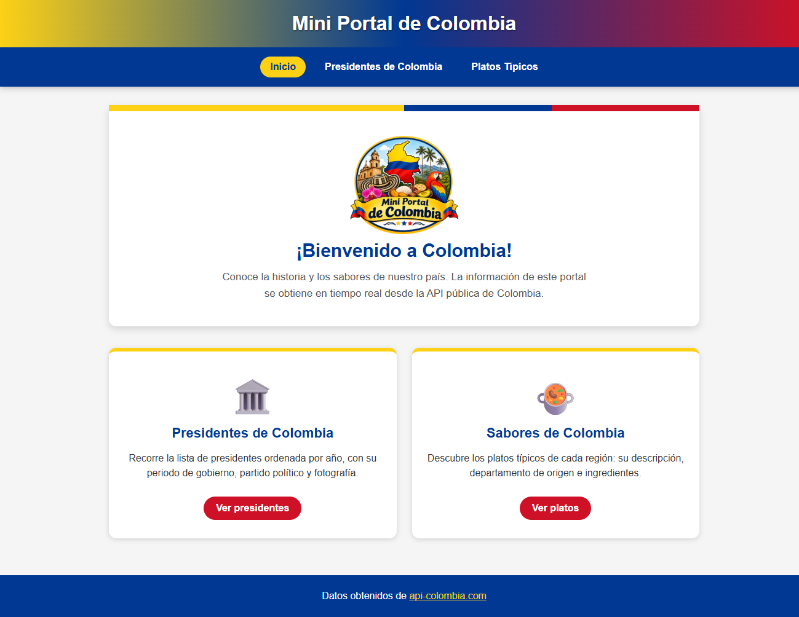
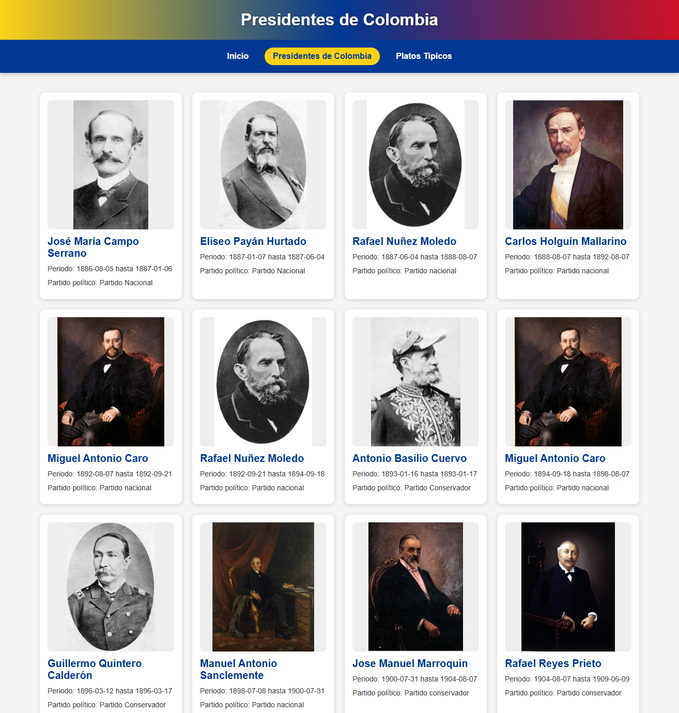
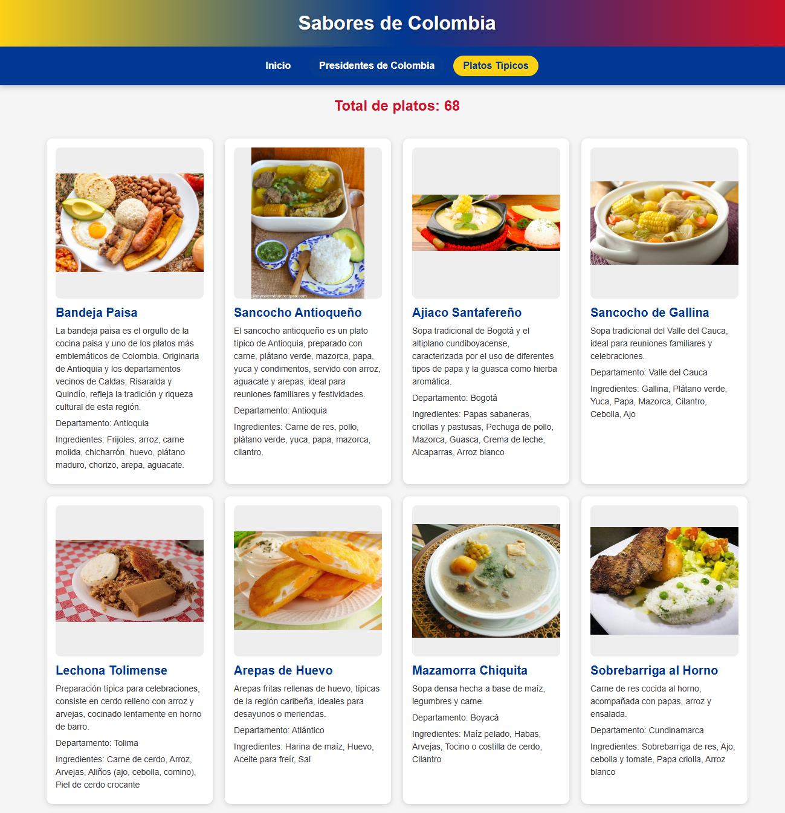

# Mini Portal de Colombia

## Descripción

Sitio web informativo sobre Colombia que consume datos en tiempo real desde la API pública [api-colombia.com](https://api-colombia.com/) y los muestra dinámicamente en el DOM con JavaScript.

El portal tiene una página de inicio y dos secciones, cada una en su propia página y conectadas entre sí mediante hipervínculos:

| Página | API | Muestra |
| --- | --- | --- |
| **Presidentes de Colombia** (`view/presidentes.html`) | `/api/v1/President` | Nombre, periodo de gobierno, partido político y fotografía, incluso la lista se ordena por año de inicio del periodo. |
| **Sabores de Colombia** (`view/platos.html`) | `/api/v1/TypicalDish` | Nombre, descripción, departamento, ingredientes e imagen, ademas de muestror el total de platos. |

### Características

- Consumo de la API con `fetch` y promesas (`.then` / `.catch`).
- Las tarjetas se construyen dinámicamente con `document.createElement` y `appendChild`.
- Mensaje de carga mientras llegan los datos.
- Manejo de errores con `catch`: si la consulta falla, se muestra un mensaje en pantalla.

## Tecnologías usadas

- **HTML5** — estructura de las páginas.
- **CSS3** — estilos, Grid, Flexbox y diseño adaptable.
- **JavaScript** — `fetch`, promesas y manipulación del DOM.
- **[API Colombia](https://api-colombia.com/)** — fuente de los datos.

## Estructura del proyecto

```
├── index.html            Página de inicio
├── README.md
├── css/
│   └── style.css         Estilos de todo el sitio
├── img/
│   └── logo.png          Logo y favicon
├── js/
│   ├── imagenes.js       Carga de imágenes
│   ├── presidentes.js    Consulta y tarjetas de presidentes
│   └── platos.js         Consulta y tarjetas de platos típicos
└── view/
    ├── presidentes.html
    └── platos.html
```

## Instrucciones de uso

1. Clona el repositorio:

   ```bash
   git clone https://github.com/Angiepad09/angie-padilla-api-colombia
   ```

2. Entra en la carpeta del proyecto.
3. Abre `index.html` en el navegador con la extensión `Live Server` de Visual Studio Code.
4. Usa el menú superior o las tarjetas de la página de inicio para ir a **Presidentes de Colombia** o **Platos Típicos**.

Se necesita conexión a internet, porque los datos y las imágenes se obtienen en línea.

## Capturas

<!-- Opcional: guarda las capturas en img/capturas/ y descomenta estas líneas


-->
### Inicio
<p align="center"></p>

### Presidentes de Colombia
<p align="center"></p>

### Sabores de Colombia
<p align="center"></p>

## Hecho por

**Angie Padilla**